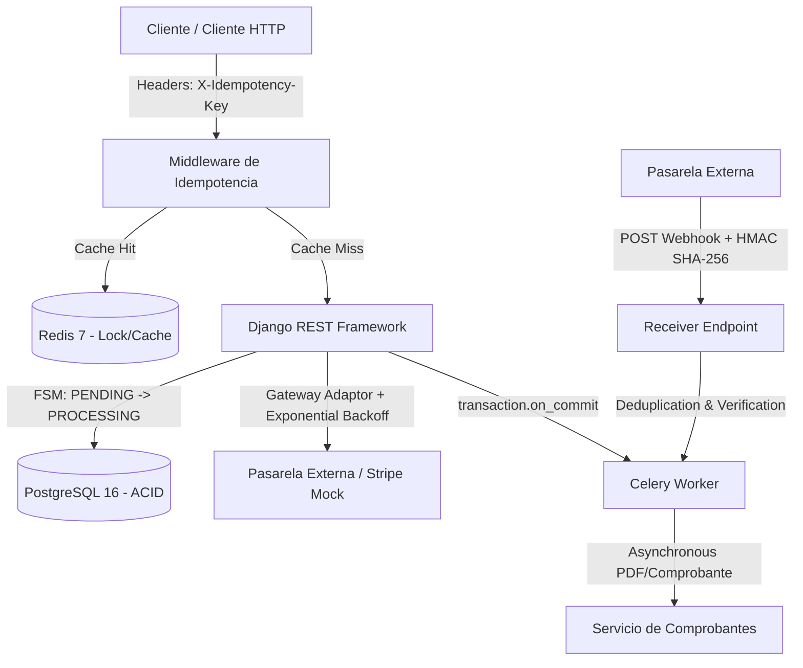

# PayPulse API 💳⚡

**PayPulse** es una API backend de alta resiliencia diseñada para el procesamiento de pagos, gestión de suscripciones e integración con pasarelas de pago externas. Implementa patrones avanzados de arquitectura distribuida para garantizar consistencia financiera, idempotencia y tolerancia a fallos.

---

## 🏗️ Arquitectura del Sistema



---

## 🎯 Patrones de Ingeniería Implementados

* **Idempotencia Garantizada (`X-Idempotency-Key`):** Intercepción a nivel de Middleware respaldada en Redis (`SETNX`) para prevenir cobros duplicados en peticiones mutativas.
* **Máquina de Estados Finita (FSM):** Flujo estricto de transiciones de estado de pago (`PENDING` $\rightarrow$ `PROCESSING` $\rightarrow$ `SUCCEEDED` / `FAILED` / `REFUNDED`) garantizado por restricciones a nivel de modelo y base de datos.
* **Capa de Resiliencia Externa:** Reintentos exponenciales con variabilidad aleatoria (*Jitter*) para mitigar fallos transitorios de red en llamadas HTTP a terceros.
* **Webhooks Criptográficos (HMAC SHA-256):** Verificación de firma en tiempo constante (`compare_digest`) para recepción de eventos asíncronos y protección contra ataques de temporización.
* **Procesamiento Asíncrono de Eventos:** Desacoplamiento de tareas pesadas (generación de comprobantes, auditorías) con Celery + Redis, sincronizado mediante `transaction.on_commit`.

---

## 🛠️ Tecnologías Utilizadas

* **Lenguaje:** Python 3.12+
* **Framework:** Django 5.1 / Django REST Framework
* **Bases de Datos:** PostgreSQL 16 (Relacional/ACID), Redis 7 (Caché & Broker)
* **Procesamiento Asíncrono:** Celery 5.4
* **Contenedores & Infraestructura:** Docker & Docker Compose

---

## 🚀 Guía de Inicio Rápido

1. **Clonar el repositorio:**
   ```bash
   git clone [https://github.com/TU_USUARIO/paypulse-api.git](https://github.com/TU_USUARIO/paypulse-api.git)
   cd paypulse-api
   ```

2. **Configurar variables de entorno:**
   ```bash
   cp .env.example .env
   ```

3. **Levantar infraestructura con Docker:**
   ```bash
   docker compose up -d
   ```

4. **Ejecutar migraciones e iniciar el servidor:**
   ```bash
   python manage.py migrate
   python manage.py runserver
   ```

### 🤖 Microservicio de Machine Learning (MLOps)
* **Modelo:** XGBoost + SMOTE (Detección de fraude ajustada para alto Recall).
* **Servidor de Inferencia:** FastAPI containerizado en Docker.
* **Integración:** Evaluación de riesgo en tiempo real en la capa de servicio de Django antes de ejecutar cobros en pasarelas externas.